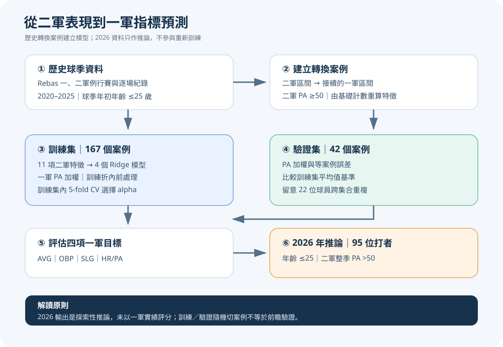
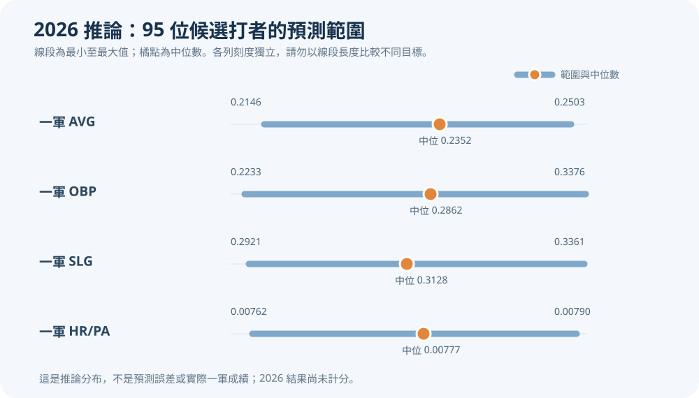
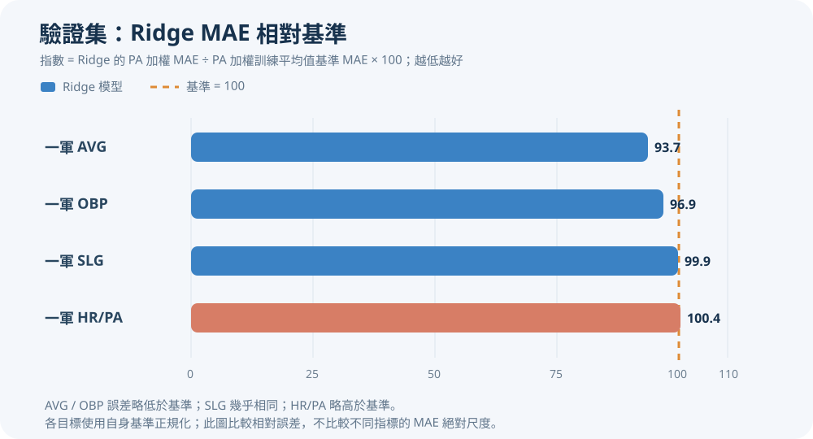
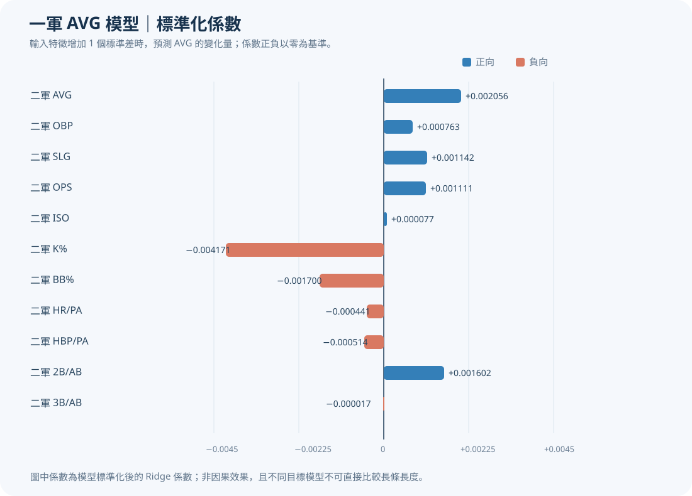
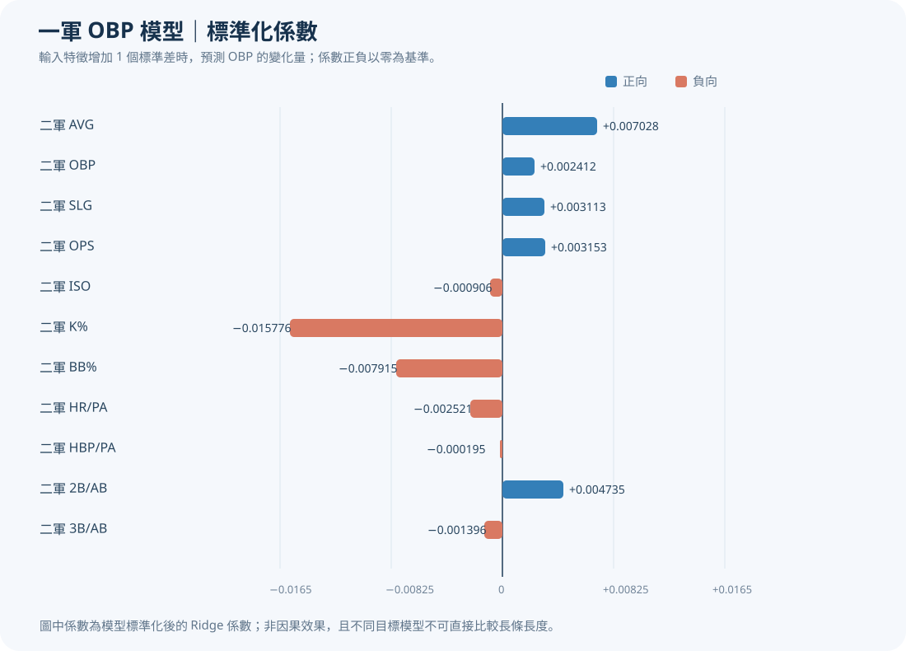
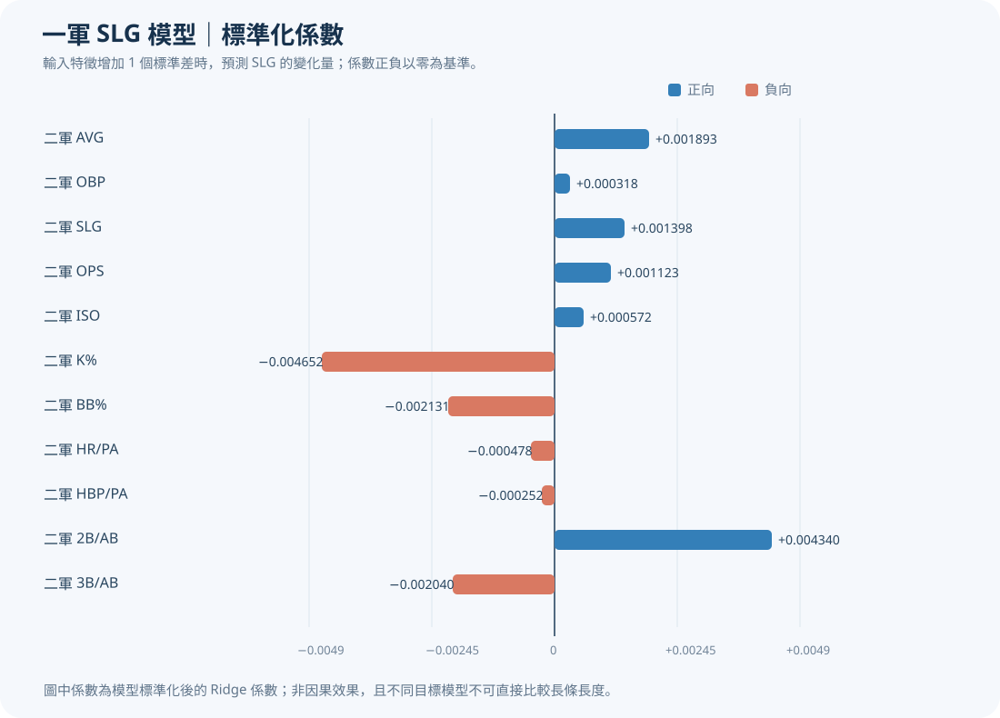
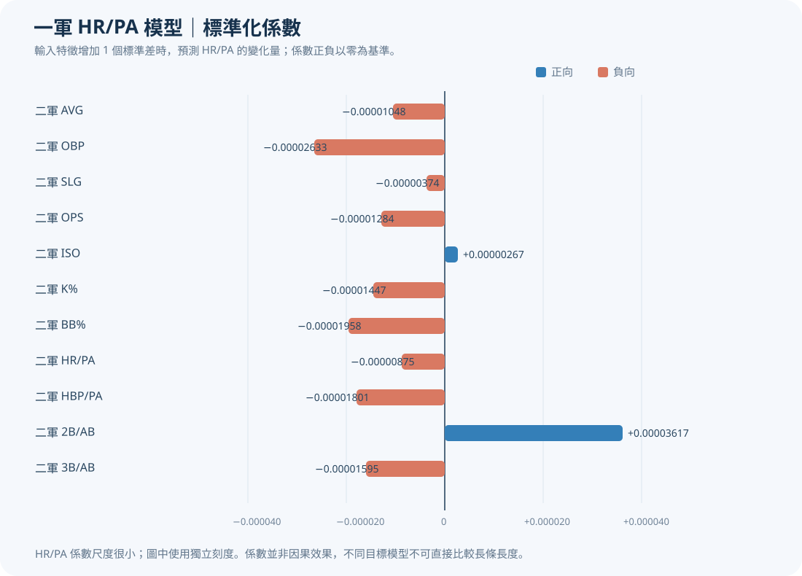

# 中職二軍年輕打者之一軍表現預測

> **研究報告草稿｜資料與模型快照：2020–2025 訓練、2026 推論**
>
> 本報告根據專案中已保存的訓練與推論輸出撰寫。圖表為研究整理圖，並非球員因果效果或正式球探評價。2026 預測尚未以一軍實際成績完成驗證。

## 摘要

本研究探討年輕打者的二軍打擊表現，能否提供其後續一軍打擊表現的預測資訊。研究使用 Rebas 野球革命公開資料，從 2020–2025 年資料建立二軍至一軍轉換案例，篩選球季年初實足年齡不超過 25 歲、二軍區間打席數至少 50 的案例，並以四個獨立 Ridge Regression 模型預測一軍打擊率（AVG）、上壘率（OBP）、長打率（SLG）與每打席全壘打率（HR/PA）。

目前訓練資料共有 209 個合格案例，依案例隨機切分為 167 個訓練案例與 42 個驗證案例。模型以一軍 PA 加權訓練，並在訓練集內使用 5-fold 交叉驗證選擇正則化參數。驗證結果顯示，相較於 PA 加權訓練平均值基準，AVG 與 OBP 的 PA 加權 MAE 分別低約 6.3% 與 3.1%；SLG 差異極小，HR/PA 則略差約 0.4%。整體而言，模型的額外預測價值有限，仍須以更嚴格的時間或球員分組驗證確認。

2026 年推論批次包含 95 位符合條件的打者；這批結果是探索性預測，不是準確度評估。由於推論使用二軍整季數據，且觀察期間可能與一軍賽季重疊，不應將其解讀為真正的前瞻預測。

## 研究設計總覽



## 1. Motivation（研究動機）

年輕打者從二軍進入一軍後，能否將二軍的打擊成果延續到更高競爭層級，是球員培育與戰力規劃的重要問題。二軍成績雖能提供球員當下表現的訊號，但不同層級的投打環境、競爭強度與出賽機會皆可能不同，因此二軍的高打擊率或長打率不必然直接轉化為一軍成功。

本研究以歷史球員轉換區間建立預測模型，檢視二軍打擊特徵與接續一軍表現的關係，並以可重現的資料流程與驗證基準，評估這些特徵是否具有超越簡單平均預測的資訊。

### 研究問題

1. 二軍打擊數據能否預測年輕打者接續的一軍 AVG、OBP、SLG 與 HR/PA？
2. Ridge 模型是否優於使用訓練資料 PA 加權平均值的基準模型？
3. 預測誤差是否會因目標指標、出賽機會或樣本切分方式而改變？
4. 以二軍整季資料推論 2026 年球員時，結果有哪些適用限制？

## 2. Importance（研究重要性）

- **球員培育參考：** 將二軍表現轉化為一軍指標的量化預測，作為球員追蹤與發展討論的補充資料。
- **球隊決策支援：** 為升降調度、培訓規劃及球員比較提供另一種分析視角；模型不取代教練、球探或醫療團隊判斷。
- **資料科學實務：** 串連球季統計、生日與逐場出賽紀錄，呈現資料品質檢查、樣本篩選、訓練與推論的完整流程。
- **方法上的警示：** 以基準模型和不同評估權重檢查預測價值，並明確呈現樣本重疊、選擇偏差及觀察窗口不同等限制。

## 3. Data Preprocessing（資料前處理）

### 3.1 資料來源與研究期間

資料來自 [Rebas 野球革命](https://www.rebas.tw/) 公開的一、二軍球季統計及逐場紀錄。訓練資料涵蓋 2020–2025 年；2026 年資料僅用於既有模型推論，不重新訓練模型。

### 3.2 研究單位與篩選條件

訓練資料的一筆觀測值是同一球員、同一球季中一段二軍出賽及其後接續的一段一軍出賽。區間依實際出賽日期界定，並非依正式升降登錄日期；球員同季往返一、二軍時，可能產生多個轉換案例。不同案例的 PA 不跨區間合併。

| 處理項目 | 訓練資料設定 |
|---|---|
| 年份 | 2020–2025 |
| 年齡 | 球季當年 1 月 1 日實足年齡 ≤25 歲 |
| 二軍門檻 | 轉換區間二軍 PA ≥50 |
| 合格案例 | 209 |
| 訓練／驗證切分 | 167／42，依案例隨機切分 |
| 已知重複出現球員 | 22 個球員 ID 同時出現在兩個子集中 |

### 3.3 特徵與預測目標

四個模型共用 11 個由二軍基礎計數重算的特徵：

| 特徵群 | 特徵 |
|---|---|
| 基本打擊率 | `minor_AVG`、`minor_OBP`、`minor_SLG` |
| 衍生打擊指標 | `minor_OPS`、`minor_ISO` |
| 三振與保送 | `minor_K_pct`、`minor_BB_pct` |
| 每打席比率 | `minor_HR_PA`、`minor_HBP_PA` |
| 每打數比率 | `minor_Double_AB`、`minor_Triple_AB` |

四個預測目標為一軍 AVG、OBP、SLG 與 HR/PA。年齡、球員姓名、球員 ID、年份及任何一軍欄位均不作為模型輸入特徵。HR/PA 是「每打席全壘打率」，不是全壘打支數。

### 3.4 缺值與資料品質

打擊率與比率由基礎計數重新計算，避免直接使用已四捨五入的排行榜率值。分母為零或目標無法定義的案例，依目標排除；不合理計數與逐場紀錄品質問題會留下排除或品質紀錄。缺失資料不直接推定為零。

## 4. Model Training（模型訓練）

### 4.1 模型形式與建模單位

本研究建立四個**彼此獨立**的 Ridge Regression 模型，分別估計一軍 AVG、OBP、SLG 與 HR/PA。每個模型的輸入都是同一組 11 項二軍特徵，但模型係數、正則化強度及目標有效樣本可不同。每一筆資料代表一個球員的「二軍區間→接續一軍區間」案例；同一球員若有多個符合條件的轉換區間，會以多筆案例保留，不先彙總成球員平均。

Ridge Regression 在平方誤差目標中加入係數平方懲罰：

```text
加權損失 = Σᵢ wᵢ (yᵢ − ŷᵢ)² + α Σⱼ βⱼ²
```

其中 `yᵢ` 是實際一軍指標、`ŷᵢ` 是模型預測、`wᵢ` 是案例的 PA 權重、`βⱼ` 是特徵係數，`α` 控制正則化強度。alpha 越大，係數通常越向 0 收縮，可降低少量樣本或相關特徵造成的係數波動；但若過大，也可能使模型欠擬合。模型包含截距，截距不受 Ridge 懲罰。

### 4.2 訓練／驗證切分與目標樣本

固定亂數種子為 42，先將 209 個合格案例依**案例**隨機切分：167 個案例作為訓練集、42 個案例作為保留驗證集。此切分不是依球員或年份分組。資料中共有 22 位球員同時出現在訓練集與驗證集，因而驗證結果不能視為「未見球員」測試或真正的未來球季測試。

每個目標只使用該目標有定義的案例：例如 AVG 的打數分母為零時，無法計算該筆 AVG；類似地，其他目標依其所需的計數分母處理。這些列只從該目標的擬合／評估中排除，不會因此把無效值填成零。各模型實際樣本數如下：

| 目標 | 訓練有效案例 | 驗證有效案例 | 訓練中未定義目標 | 驗證中未定義目標 |
|---|---:|---:|---:|---:|
| 一軍 AVG | 164 | 42 | 3 | 0 |
| 一軍 OBP | 166 | 42 | 1 | 0 |
| 一軍 SLG | 164 | 42 | 3 | 0 |
| 一軍 HR/PA | 167 | 42 | 0 | 0 |

### 4.3 前處理與避免資料洩漏

每個模型依序使用以下 pipeline：

1. **中位數補值：** 對模型輸入特徵中的缺值，以當次擬合資料的特徵中位數補值。若某一特徵在當次訓練資料全數缺失，程式會停止並回報錯誤，而不是默默產生模型。
2. **Z-score 標準化：** 將每個特徵轉成以訓練資料平均數為中心、標準差為單位的尺度：

   ```text
   zⱼ = (xⱼ − 訓練平均數ⱼ) ÷ 訓練標準差ⱼ
   ```

3. **Ridge 擬合：** 在標準化特徵上，以選定 alpha 與 PA 權重估計係數。

補值器與標準化器都只在目前的訓練資料上 `fit`。交叉驗證時，每一折各自重新估計補值中位數、平均數與標準差；保留驗證集只使用訓練資料估得的參數做轉換，沒有參與前處理估計、模型選參或擬合。這可避免驗證資料統計量洩漏進訓練流程。

### 4.4 一軍 PA 加權

四個主模型皆以案例接續的一軍 PA 作為樣本權重。對每次模型擬合，權重正規化方式為：

```text
正規化權重ᵢ = 該案例一軍 PAᵢ ÷ 當次訓練資料的一軍平均 PA
```

例如一個案例的一軍 PA 是該折平均值的兩倍，其對加權擬合損失的貢獻權重為兩倍。程式在交叉驗證的每個訓練折及最終訓練集內分別計算平均 PA，避免使用該驗證折的 PA 決定擬合權重。評估時則以保留驗證案例的一軍 PA 作為評分權重。

PA 加權是研究設計的選擇：它讓一軍出賽機會較多、目標表現相對較有觀察量的案例，在訓練與指定評估中影響較大；但它不會消除短期表現的隨機波動，也不代表出賽較多者必然更具代表性。PA 不屬於推論模型的 11 項特徵，預測時不需要提供一軍 PA。

### 4.5 交叉驗證與 alpha 選擇

只使用訓練集，對每個目標分別執行 5-fold 交叉驗證。五折切分以固定 seed＝42 打亂案例；每次以四折訓練、剩下一折預測，最後將該目標所有訓練案例的折外預測合併，計算 pooled out-of-fold PA 加權 MAE：

```text
PA 加權 MAE = Σᵢ PAᵢ × |實際值ᵢ − 折外預測值ᵢ| ÷ Σᵢ PAᵢ
```

候選 alpha 為 `0.01、0.1、1、10、100、1000、10000`；每個目標選擇訓練集內加權折外 MAE 最低者。這個選參分數用於挑選 alpha，不是最後的保留驗證分數。

| 預測目標 | 選定 alpha | 最低訓練 CV PA 加權 MAE |
|---|---:|---:|
| 一軍 AVG | 1000 | 0.06876 |
| 一軍 OBP | 100 | 0.06466 |
| 一軍 SLG | 1000 | 0.10086 |
| 一軍 HR/PA | 10000 | 0.00848 |

HR/PA 的最佳 alpha 是搜尋候選值的上限 10000。這只表示在目前候選範圍與此項 CV 指標下，10000 的分數最低；不代表它是普遍最佳值，也不保證繼續擴大 alpha 就會改善泛化表現。

### 4.6 最終擬合與保留集評估

選定每個目標的 alpha 後，pipeline 在該目標的完整訓練子集重新擬合，再對完全保留的 42 個案例產生預測。報告同時保留未加權與 PA 加權的 MAE、RMSE、R²，並與兩種訓練集平均值基準比較：案例等權的訓練平均值，以及依訓練 PA 加權的訓練平均值。比較模型與基準時，需使用相同驗證案例及相同權重方式。

模型係數與補值／標準化參數分別保存於 `coefficients.csv` 與 `preprocessing.csv`；逐案例的實際值、預測值與基準值保存於 `validation_predictions.csv`；CV 各 alpha 分數與樣本、切分及版本資訊則保存於 `training_cv.csv`、`metrics.json` 與 `manifest.json`。

> **驗證範圍聲明：** 此處的保留驗證集只隔離了案例，沒有隔離球員或年份。同一球員跨訓練／驗證集合，以及模型可能訓練於比某些驗證案例更晚的球季，都限制了泛化結論。若研究問題是預測未來球季，應改用時間順序切分；若研究問題是預測新球員，則應以球員 ID 分組切分。

## 5. Prediction（預測）

2026 年推論載入既有的四個模型，對符合「年初實足年齡 ≤25 歲、二軍整季 PA >50」的打者預測一軍 AVG、OBP、SLG 與 HR/PA。候選資格不要求球員已經有一軍打席；未列入一軍排行榜的球員保留空白的一軍參考欄位，不以零取代。

| 2026 推論摘要 | 結果 |
|---|---:|
| 預測球員 | 95 |
| 年齡範圍 | 18–25 歲 |
| 二軍 PA 範圍 | 51–303 |
| 曾出現在訓練案例的球員 | 37 |
| 一軍排行榜未列出 | 29 |



| 預測目標 | 平均 | 中位數 | 範圍 |
|---|---:|---:|---:|
| 一軍 AVG | 0.2345 | 0.2352 | 0.2146–0.2503 |
| 一軍 OBP | 0.2851 | 0.2862 | 0.2233–0.3376 |
| 一軍 SLG | 0.3127 | 0.3128 | 0.2921–0.3361 |
| 一軍 HR/PA | 0.00777 | 0.00777 | 0.00762–0.00790 |

這些數值是模型輸出，不是實際一軍成績或球員排名。HR/PA 的 0.00777 約等於每 100 PA 預期 0.777 支全壘打的率值解讀；它不代表球員一定會擊出該數量。2026 推論的觀察窗口為二軍整季，且可能與同年一軍出賽重疊，因此本批結果尚未構成前瞻驗證。

## 6. Model Analysis（模型分析）

### 6.1 驗證集效能

下表比較各目標在驗證集上的 PA 加權誤差，與「訓練集一軍 PA 加權平均值」基準。所有值使用同一驗證案例與 PA 加權評估；MAE、RMSE 越低越好。

| 目標 | Ridge MAE | 基準 MAE | MAE 相對改善 | Ridge RMSE | 基準 RMSE | Ridge R² |
|---|---:|---:|---:|---:|---:|---:|
| AVG | 0.05891 | 0.06285 | 6.3% | 0.09837 | 0.10095 | -0.031 |
| OBP | 0.06348 | 0.06552 | 3.1% | 0.11058 | 0.11213 | -0.056 |
| SLG | 0.10633 | 0.10648 | 0.1% | 0.14860 | 0.15190 | 0.025 |
| HR/PA | 0.00926 | 0.00923 | -0.4% | 0.00991 | 0.00988 | -0.015 |

> **解讀：** MAE 相對改善定義為 `(基準 MAE − Ridge MAE) ÷ 基準 MAE`。正值代表 Ridge 誤差較低，負值代表 Ridge 較差。各目標尺度不同，不應直接比較不同列的 MAE 絕對值。

驗證集中每個目標均有 42 個案例，合計一軍 PA 為 573。AVG 與 OBP 的誤差略低於基準；SLG 幾乎相同；HR/PA 略差於基準。R² 除 SLG 外皆略為負值，顯示目前驗證集上的模型解釋能力有限。這些結果不足以支持模型已能穩定預測年輕打者的一軍成績。



**圖表解讀：** 橘色虛線是基準指數 100；藍色條低於 100 代表 Ridge 的 PA 加權 MAE 較低，紅色條高於 100 則代表誤差較高。AVG 指數約 93.7，表示 MAE 比基準低約 6.3%；OBP 約 96.9，低約 3.1%；SLG 約 99.9，與基準幾乎相同；HR/PA 約 100.4，略高於基準。改善幅度整體不大，且這張圖呈現的是同一驗證集上的誤差比值，不代表模型已具備穩定的未來預測能力。

### 6.2 特徵係數視覺化

以下分別呈現四個 Ridge 模型的標準化係數。係數表示在其他輸入固定時，該特徵增加 1 個標準差所對應的預測變化；右側為正向係數，左側為負向係數。每張圖依各自模型的係數範圍縮放，**不同圖之間的長條長度不宜直接比較**。

特徵名稱對照：AVG＝打擊率、OBP＝上壘率、SLG＝長打率、OPS＝上壘加長打率、ISO＝純長打率、K%＝三振率、BB%＝保送率、HR/PA＝每打席全壘打率、HBP/PA＝每打席觸身球率、2B/AB＝每打數二壘安打率、3B/AB＝每打數三壘安打率。

#### 一軍 AVG 模型



**圖表解讀：** 二軍三振率（K%）是此模型最明顯的負向係數；二軍 AVG 與二壘安打／打數（2B/AB）則是較大的正向係數。三壘安打率的係數幾乎為零，表示在控制其餘輸入後，模型給予它的線性調整幅度很小。這些是控制其他相關特徵後的係數方向，不是單變項相關或因果效果。

#### 一軍 OBP 模型



**圖表解讀：** 二軍三振率是最大的負向係數，保送率也呈負向；二軍 AVG、二壘安打率、OPS 與 SLG 呈正向係數，其中 AVG 的正向係數較大。OBP 的直接輸入係數相對小。由於 AVG、OBP、OPS 等特徵彼此重疊，出現與直覺不完全一致的條件係數方向並不意外，不能據此推論增加某項表現會降低上壘率。

#### 一軍 SLG 模型



**圖表解讀：** 二軍二壘安打率是較大的正向係數；二軍 AVG、SLG 與 OPS 也呈正向。三振率則是較大的負向係數，三壘安打率與保送率亦為負向。這些方向均是在其他特徵固定下估計，並非各項特徵單獨與 SLG 的原始關聯；例如長打率與 OPS、ISO 的資訊部分重疊。

#### 一軍 HR/PA 模型



**圖表解讀：** 此圖的刻度是百萬分之一量級，整體係數幅度遠小於 AVG、OBP、SLG 模型各自的係數刻度。二壘安打率是較明顯的正向係數；OBP、保送率與觸身球率是較明顯的負向係數。不過該模型驗證 MAE 未優於基準，且個別預測的 HR/PA 範圍相當集中，因此係數的正負差異不應被當成有實用區辨力的全壘打能力排名。

上述係數是控制模型中其他特徵後的條件關聯，不是因果效果或獨立的特徵重要性。AVG、OBP、SLG、OPS 與 ISO 等特徵彼此相關，因此個別係數可能受到其他特徵影響。尤其 HR/PA 模型的係數整體很小，需搭配預測誤差與基準比較解讀。

#### 綜合觀察

根據四個模型的標準化係數，二軍部分打擊指標與模型的一軍預測值呈現值得進一步檢驗的條件關聯：

- **2B/AB（二壘安打率）**在 SLG 與 HR/PA 模型中呈現較明顯的正向係數，表示在控制模型中的其他輸入後，較高的二軍二壘安打率與較高的模型預測值相伴。這項結果可作為評估年輕打者長打相關表現的探索線索，但不能據此認定它會造成一軍長打率或全壘打率上升；HR/PA 模型的整體係數幅度很小，且驗證表現沒有優於基準，需特別審慎解讀。
- **K%（三振率）**在 AVG 與 SLG 模型中呈現較明顯的負向係數，表示在其他輸入固定時，較高的二軍三振率對應較低的模型預測值。因此，K% 可作為檢視二軍打擊表現能否延續至一軍時的參考指標之一；但此為模型中的條件關聯，不代表降低三振率必然造成一軍 AVG 或 SLG 上升。

由於輸入特徵彼此相關，這些係數反映的是多變項模型中的條件關聯，不是單一指標的獨立影響或因果效果。且模型整體驗證優勢有限，以上觀察宜視為後續研究假設，而非已確認的球員評估規則。

### 6.3 誤差解讀與模型限制

1. **驗證方式不是嚴格的未來預測測試。** 案例隨機切分導致 22 位球員同時出現在訓練集與驗證集；同一球員的不同案例可能共享個人能力與生涯資訊。
2. **小樣本且不確定性高。** 驗證集只有 42 個案例，且 573 個 PA 的分布可能不均。PA 加權評估會讓較多 PA 的案例對分數影響更大。
3. **轉換案例的選擇偏差。** 訓練資料來自已取得一軍出賽機會的球員，不能直接代表所有仍在二軍的打者。
4. **訓練與推論的觀察窗口不同。** 訓練以二軍區間後接一軍區間建立案例；2026 推論使用二軍整季資料，時間窗口可能交錯。
5. **模型只估計統計關聯。** Ridge 係數與預測結果不是因果效果，不能證明某一項二軍技能會造成一軍成績變化。
6. **輸出差距需謹慎解讀。** 點預測未包含完整的個人不確定區間；不宜將微小差異視為可靠排名。

### 6.4 後續研究建議

- **時間外驗證：** 以前幾年訓練、較晚年份測試，例如以 2020–2023 年訓練、2024 年驗證，再以 2025 年作最後測試，模擬實際部署情境。
- **球員分組驗證：** 依球員 ID 分組，確保同一球員不會同時出現在訓練集與驗證集。
- **不確定性評估：** 使用球員群集 bootstrap 或適當的預測區間方法，呈現樣本與重抽樣帶來的不確定性。
- **分層誤差診斷：** 按一軍 PA、二軍 PA、年份與年齡層檢查誤差，辨別模型是否只對某些出賽型態有用。
- **外部資訊與基準：** 在避免資料洩漏的前提下，評估年齡、聯盟環境或球員歷年表現是否能改善預測；新增模型應與目前基準在相同切分下比較。
- **2026 追蹤驗證：** 待一軍實際成績完整且時間窗口明確後，另建評估資料集計算 MAE、RMSE 與校準情形，不以預測名單本身宣稱模型成功。

## 7. Prospect Recommendations（潛力新秀推薦）

本節將模型輸出整理為**優先追蹤名單**，不是對球員未來成績的保證，也不等同於官方新秀資格或選秀評價。排序主要採模型預測 OPS（預測 OBP＋預測 SLG），同時列出二軍打席數與實際二軍 OPS，協助讀者辨別模型預測與已觀察表現。

### 7.1 候選球員篩選（Candidate Selection）

本節納入 2026 年推論批次中**所有年初實足年齡 ≤25 歲、二軍整季 PA >50 的 95 名候選球員**，不再額外限制為 22 歲以下或一軍 PA 不超過 50。此處「25 歲以下」依專案規則包含 25 歲。預測資格不要求球員已有一軍出賽；未列於一軍榜的球員仍納入推論，缺少的一軍參考數據保留為空白。

為方便呈現，以下從完整 95 人候選池中依預測 OPS（預測 OBP＋預測 SLG）排序，展示前十位作為代表。這不是只分析這十人，其餘符合條件的球員也都包含在候選池中。

### 7.2 模型預測結果（Prediction Results）

四項指標的打擊面向不同：

- **AVG（打擊率）：** 安打數相對於打數的比率。
- **OBP（上壘率）：** 反映安打、保送及觸身球等上壘結果。
- **SLG（長打率）：** 反映每打數的壘打數與長打產出。
- **HR/PA（每打席全壘打率）：** 全壘打支數相對於打席的比率；不是預測全壘打支數。
- **預測 OPS：** 本節以預測 OBP＋預測 SLG 計算，作為簡單的綜合比較指標；它不是本模型直接訓練的目標，不能取代其他指標或正式球探評估。

| 排名 | 球員 | 年齡 | 二軍 PA | 二軍 OPS | 預測 AVG | 預測 OBP | 預測 SLG | 預測 OPS | 預測 HR/PA |
|---:|---|---:|---:|---:|---:|---:|---:|---:|---:|
| 1 | 張育豪 | 18 | 57 | 1.029 | 0.250 | 0.330 | 0.336 | **0.667** | 0.00773 |
| 2 | 湯家豪 | 25 | 134 | 0.812 | 0.248 | 0.338 | 0.328 | **0.666** | 0.00776 |
| 3 | 顏采丞 | 22 | 120 | 0.837 | 0.245 | 0.320 | 0.329 | **0.649** | 0.00782 |
| 4 | 曾頌恩 | 25 | 72 | 1.071 | 0.247 | 0.315 | 0.330 | **0.645** | 0.00773 |
| 5 | 蔡琞傑 | 18 | 175 | 0.902 | 0.245 | 0.318 | 0.326 | **0.644** | 0.00774 |
| 6 | 何品室融 | 20 | 104 | 1.006 | 0.243 | 0.309 | 0.328 | **0.637** | 0.00764 |
| 7 | 全紹凱 | 19 | 207 | 0.793 | 0.243 | 0.311 | 0.326 | **0.637** | 0.00785 |
| 8 | 田子杰 | 22 | 136 | 0.716 | 0.243 | 0.318 | 0.319 | **0.636** | 0.00778 |
| 9 | 董子恩 | 22 | 90 | 0.609 | 0.240 | 0.316 | 0.320 | **0.636** | 0.00783 |
| 10 | 張士綸 | 20 | 109 | 0.755 | 0.242 | 0.313 | 0.324 | **0.636** | 0.00782 |

這十位的預測 OPS 約介於 **0.636–0.667**。預測 HR/PA 大約介於 0.00764–0.00785，數值相當集中，表示本模型的 HR/PA 較不適合作為這批候選者的主要排序依據。上述排序只用來呈現模型輸出差異，名次間的小幅差距不代表具有統計上明確的實力差異。

#### 預測上壘率（OBP）前五名

以下排名使用完整 95 人候選池，依模型預測 OBP 由高至低排列：

| 排名 | 球員 | 年齡 | 二軍 PA | 預測 OBP | 預測 SLG |
|---:|---|---:|---:|---:|---:|
| 1 | 湯家豪 | 25 | 134 | **0.338** | 0.328 |
| 2 | 張育豪 | 18 | 57 | **0.330** | 0.336 |
| 3 | 顏采丞 | 22 | 120 | **0.320** | 0.329 |
| 4 | 蔡琞傑 | 18 | 175 | **0.318** | 0.326 |
| 5 | 黃&#x52BC;希 | 21 | 78 | **0.318** | 0.318 |

**結果解讀：** 湯家豪的預測 OBP 最高（0.338），張育豪排名第二（0.330）。蔡琞傑與黃&#x52BC;希的預測 OBP 四捨五入後同為 0.318；表中依未四捨五入的預測值排序。OBP 反映上壘面向，應與 AVG、SLG 及球員實際二軍打席一併解讀，不等同於整體打擊價值。

#### 預測長打率（SLG）前五名

以下排名同樣使用完整 95 人候選池，依模型預測 SLG 由高至低排列：

| 排名 | 球員 | 年齡 | 二軍 PA | 預測 SLG | 預測 OBP |
|---:|---|---:|---:|---:|---:|
| 1 | 張育豪 | 18 | 57 | **0.336** | 0.330 |
| 2 | 曾頌恩 | 25 | 72 | **0.330** | 0.315 |
| 3 | 顏采丞 | 22 | 120 | **0.329** | 0.320 |
| 4 | 湯家豪 | 25 | 134 | **0.328** | 0.338 |
| 5 | 何品室融 | 20 | 104 | **0.328** | 0.309 |

**結果解讀：** 張育豪的模型預測 SLG 最高（0.336），其次為曾頌恩（0.330）與顏采丞（0.329）。湯家豪與何品室融預測值四捨五入後同為 0.328；表中依未四捨五入的預測值排序。張育豪雖居首位，但二軍 PA 為 57，樣本相對較少，排名需保守看待。

#### 預測全壘打率（HR/PA）前五名

以下依模型預測的一軍 HR/PA 由高至低排列。HR/PA 是預測全壘打支數除以打席數的比率，不是全壘打支數預測。

| 排名 | 球員 | 年齡 | 二軍 PA | 二軍 HR | 二軍 HR/PA | 預測一軍 HR/PA |
|---:|---|---:|---:|---:|---:|---:|
| 1 | 張家豪 | 21 | 87 | 1 | 0.01149 | **0.007897** |
| 2 | 陽念祖 | 20 | 198 | 0 | 0.00000 | **0.007880** |
| 3 | 黃冠倫 | 22 | 124 | 0 | 0.00000 | **0.007878** |
| 4 | 劉子杰 | 23 | 80 | 1 | 0.01250 | **0.007873** |
| 5 | 林靖凱 | 25 | 83 | 1 | 0.01205 | **0.007873** |

**結果解讀：** 前五名的預測 HR/PA 約落在 **0.007873–0.007897**，差距非常小，四捨五入至小數點後四位時皆約為 0.0079。因此，這份排序不宜解讀為球員全壘打能力有明確高下。尤其陽念祖與黃冠倫的二軍全壘打數為零，但仍排在預測 HR/PA 前段，反映此模型輸出集中且區辨力有限；本研究的 HR/PA 驗證誤差亦未優於基準。建議將此表視為模型輸出紀錄，不作實際全壘打產量或球員排名結論。

### 7.3 潛力新秀分析（Prospect Analysis）

- **張育豪：** 在完整候選池中預測 OPS 最高（0.667），預測 AVG 為 0.250；二軍有 57 PA、OPS 1.029。其預測值得留意，但二軍 PA 為本表最低，模型不確定性可能較高，應等待更多打席與實際一軍表現佐證。
- **湯家豪：** 年齡 25 歲，預測 OBP 為前十最高（0.338），預測 OPS 0.666；二軍有 134 PA。這是本次擴大至所有 25 歲以下後進入前段的球員，顯示分析不應只聚焦較年輕子群。
- **黃鈞麟：** 年初實足年齡 22 歲。2026 推論資料快照中，他二軍出賽 72 場、253 PA、212 AB、69 安打，包含 14 支二壘安打、3 支三壘安打、0 支全壘打，另有 34 次保送與 29 次三振；二軍 AVG 為 **0.325**、OBP **0.422**、SLG **0.420**、OPS **0.842**。模型預測其一軍 AVG **0.242**、OBP **0.308**、SLG **0.321**，以 OBP＋SLG 計算的預測 OPS 約 **0.629**，預測 HR/PA 為 **0.00774**。同一資料快照的一軍參考資料僅列 1 場、3 PA，樣本不足以代表穩定的一軍成績；而且黃鈞麟曾出現在訓練案例中，因此這項預測也不能視為對未見球員的獨立驗證。
- **蔡琞傑：** 年齡 18 歲，二軍 175 PA、OPS 0.902；模型預測 OPS 0.644。可持續觀察其上壘與長打表現能否延續到更高層級。
- **全紹凱：** 年齡 19 歲、二軍 207 PA，預測 OPS 0.637。相較於只有少量 PA 的候選者，較多打席提供較完整的二軍觀察量；不過模型並未輸出預測區間，仍不能把點估計當成精確能力值。

上述案例呈現不同理由的追蹤價值：有些球員預測 OPS 較高，有些球員則有較多二軍打席可供觀察；25 歲球員也保留在候選範圍內。模型沒有納入守備位置與品質、跑壘、球速與球路辨識、傷病、球場環境或球隊升降策略；因此「潛力」應理解為值得整合其他資訊持續追蹤，而非單靠打擊模型得出的完整球員評價。

### 7.4 球隊應用建議（Team Strategy）

1. **作為篩選提示，而非升上一軍的自動門檻。** 可先用年齡、二軍 PA 與模型預測整理觀察名單，再由教練與球探檢視技術、守備、健康及球隊需求。
2. **依指標拆解培養方向。** AVG、OBP、SLG 與 HR/PA 分別反映不同打擊面向；不宜只看預測 OPS，也應查看二軍原始計數與比率，確認模型訊號是否與球員實際打法相符。
3. **考慮樣本量與預測不確定性。** 對 PA 較少或預測值彼此接近的球員，不宜進行細微名次比較；可優先安排持續觀察，待累積更多打席再評估。
4. **建立逐季追蹤表。** 保存每次預測時間、特徵窗口、實際一軍 PA 與後續表現，賽季結束後計算誤差並檢查模型是否對不同年齡、打席量或球員群體有系統性偏差。
5. **用時間外資料驗證後再擴大應用。** 在將模型納入球隊正式流程前，應先以未參與模型訓練的後續球季驗證，並與簡單基準及球探評估比較。

## 結論

本研究建立了從中職二軍打擊特徵預測年輕打者一軍表現的完整流程，並完成 AVG、OBP、SLG 與 HR/PA 四項 Ridge 模型。現有 PA 加權驗證結果中，AVG 與 OBP 相較訓練集加權平均基準有小幅誤差改善，SLG 幾乎無差異，HR/PA 則略差；整體證據尚不足以主張模型具有穩定、可泛化的預測優勢。

因此，現階段最合宜的定位是**探索性球員評估工具**。後續研究應優先處理球員跨集合重疊、時間外泛化、選擇偏差與預測不確定性，再評估模型是否能支援實際的球員培育決策。

## 資料來源與重現資訊

- 資料來源：[Rebas 野球革命](https://www.rebas.tw/)。
- 訓練資料年份：2020–2025。
- 訓練輸出批次：`.training_outputsminor50_major_pa_weighted_run1`。
- 2026 推論輸出批次：`prediction_outputs/2026_all_minor50_run1`。
- 資料抓取、篩選、轉換案例整理、訓練與預測的程式及執行方式，請參閱專案 [readme.md](./readme.md)。
- 使用或散布原始資料前，請確認網站最新使用條款及研究／競賽授權，並在發表時註明資料來源。
